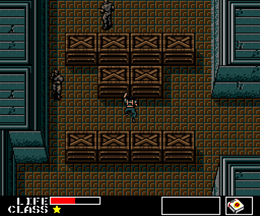
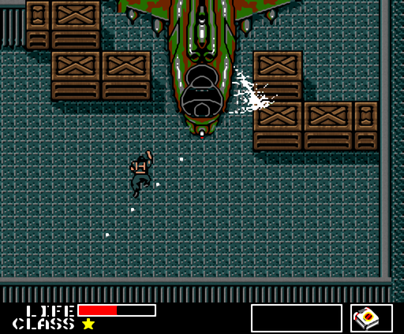

# Metal Gear for Haiku

**Metal Gear** (Konami, MSX2, 1987) as a native Haiku game. The original
program is rewritten in C++, so it plays exactly like the MSX version, and
it adds sharper graphics, better music and a few comforts the MSX could not
offer. No emulator is involved.

 

*With the HD room tiles made from your own ROM. Right: the fight with the Hind D.*

## What is different from the original

The game itself is unchanged: the same rooms, enemies, items, radio calls,
passwords and ending, tick for tick as on the MSX. What changed is how it
looks, sounds and is handled:

- **HD room tiles.** Every room can be shown with detailed tiles: tanks in
  army green, wooden crates, sharper walls and floors. They are made once
  from your own ROM with one command; you can also draw your own.
- **Smooth picture at any size.** The game fills the window or the whole
  screen, with a smoothing filter (or sharp pixels if you prefer).
- **No sprite flicker.** The MSX could show only 8 sprites on a line and
  made the rest flicker. Here every enemy and bullet stays visible.
- **Enhanced music.** The original music played on real instruments
  (GeneralUser GS SoundFont) with reverb. The original sound is one key
  away, also with the extra SCC voices of the SCC versions of the game.
- **Stereo** for the original sound, and **smooth room changes** with a
  short fade.
- **60 frames per second**, as the MSX2 at 60 Hz, without the slowdown of
  the original when much happens at once.
- **Settings window** (F6) for all of this, remembered between runs.
- **Saving** works as in the original, to a tape image on disk that MSX
  emulators can read as well.
- **Translations and variants**: the English and Japanese versions and the
  French, Russian and Remix fan versions all run, including the SCC
  versions.

## Getting the game running

The game ROM is not included. Use a dump of a cartridge you own, or build it
from the annotated disassembly by Manuel Pazos
([GuillianSeed/MetalGear](https://github.com/GuillianSeed/MetalGear)).

Build and install the package, then start Metal Gear from the Deskbar menu
(Applications). On the first start it asks for the ROM and keeps a copy; you
can also drop a ROM file on the game window at any time.

    make package
    pkgman install ./metalgear-1.0.0-1-x86_64.hpkg

To build and run without installing:

    make
    ./MetalGear

Made for Haiku R1/beta6 (x86_64), tested on hrev59866+92.

### HD room tiles

Make them once from your ROM (it says what to install if something is
missing, and puts the tiles where the game finds them):

    /boot/system/apps/MetalGear/tools/make_hd.sh    # with the package
    tools/hd/make_hd.sh                              # from the source

Start the game again to see them; F6 switches them on or off.

## Playing

| Key | |
|---|---|
| Arrows | move |
| Space | fire, use |
| M or N | second button (also skips radio texts) |
| F1 | pause |
| F2 | weapons |
| F3 | equipment |
| F4 | radio |
| Return | confirm a name |

**Saving and loading** work as in the original: press **F1** to pause, then
**F5** to save or **F4** to load. Type a name and press Return. After saving
answer **Y** to check the save and **N** to the question "retry?", then press
F1 to play on. After game over, F5 continues.

Keys of this version:

| Key | |
|---|---|
| F6 | settings |
| F7 | picture: smooth, sharp or whole pixels |
| F8 | timing display |
| F9 or Print Screen | screenshot (in your home folder) |
| F10 | music: enhanced, original, original with SCC |
| F11 | full screen |
| F12 or Alt+Q | quit |

Your ROM, settings, saves and HD tiles are kept in
`~/config/settings/MetalGear`.

## More

Technical notes, supported ROM versions in detail, the tests and tools:
[docs/DEVELOPMENT.md](docs/DEVELOPMENT.md).

The source code is under the MIT licence (`LICENSE`). The included
instruments are from GeneralUser GS by S. Christian Collins
(`data/LICENSE.GeneralUser.txt`).

Metal Gear is a trademark of Konami. This project is not affiliated with or
endorsed by Konami, and contains no game data: the ROM and the graphics and
music made from it stay on your own computer.

Port by Akakor, developed with the help of Claude (Anthropic).
